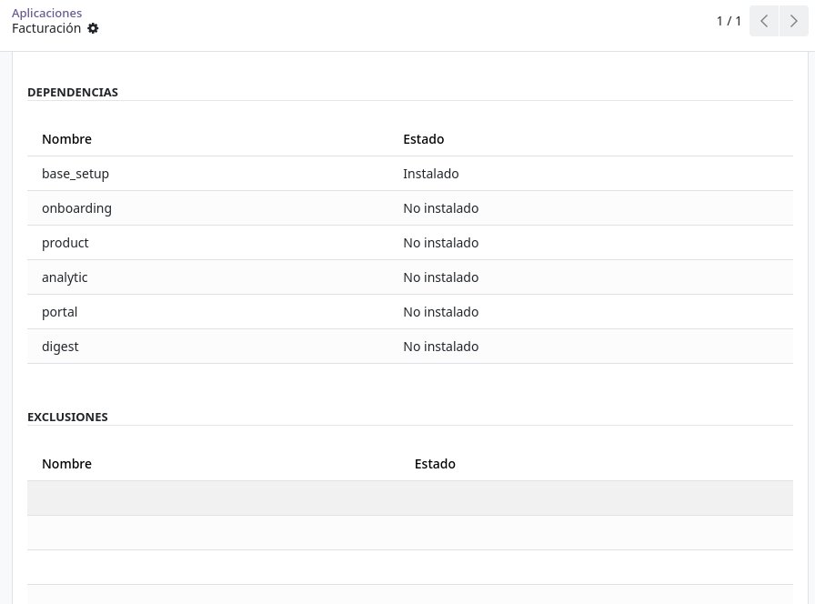
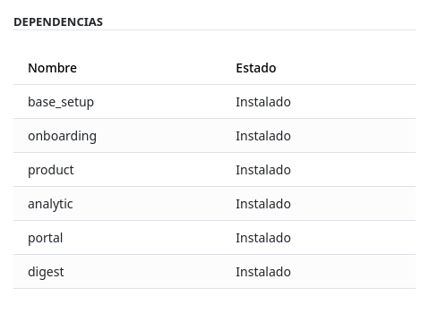
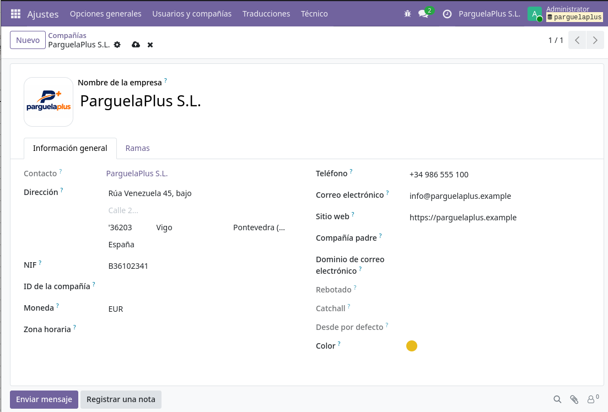
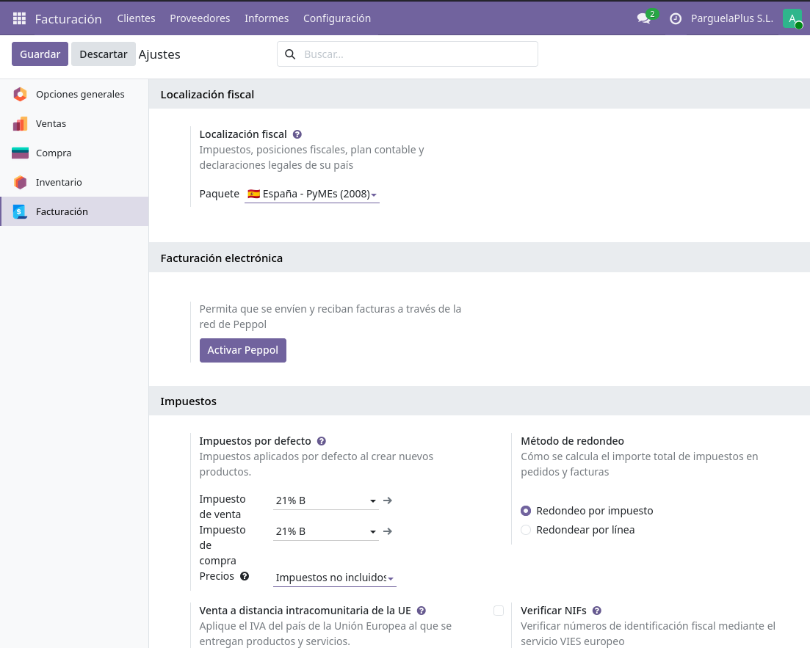
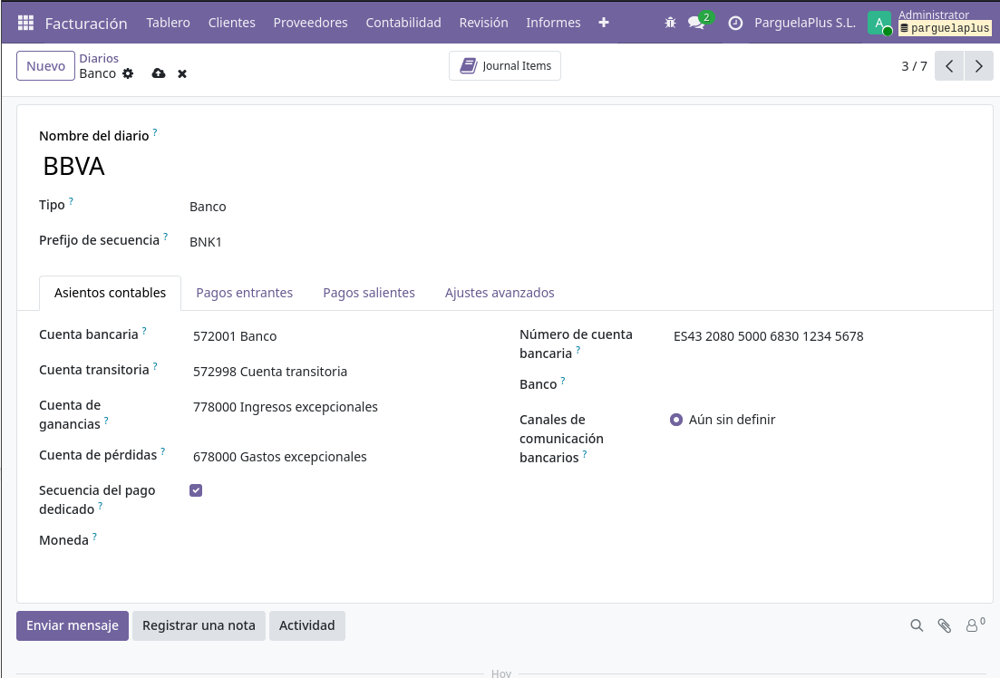
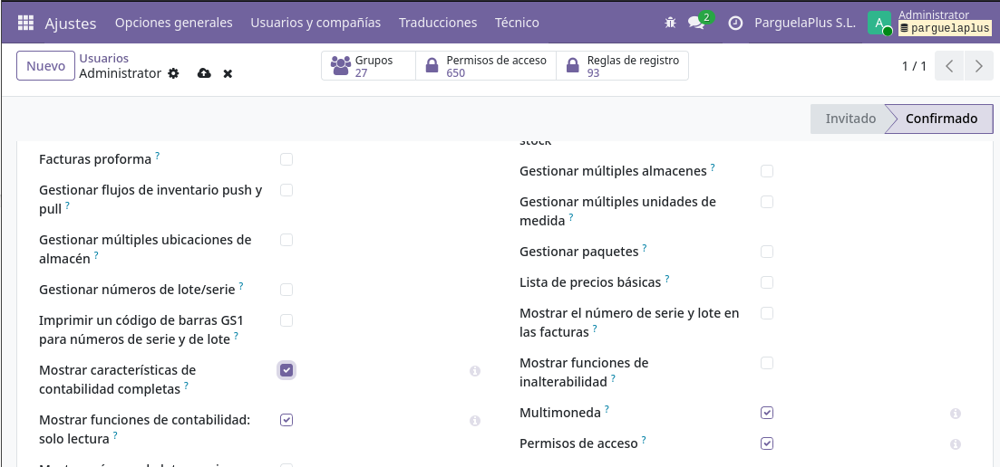
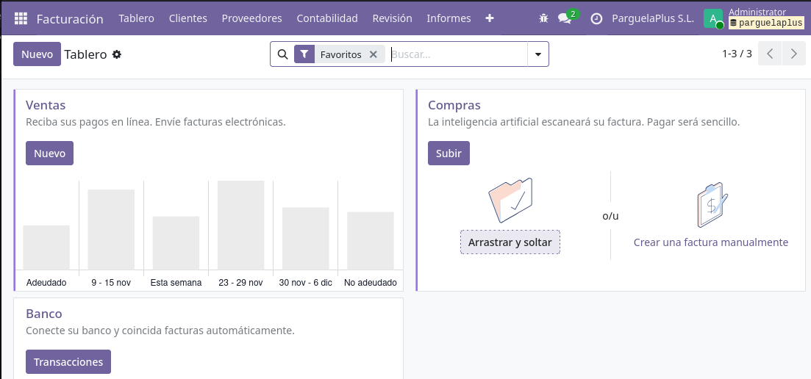

# Tarea 11 - Configuracion y carga de datos

## Ejercicio 1 - Dependencias

## Ejercicio 2 - Configuración

### Datos de la empresa

### Ajustes de facturacion

### Datos del banco

### Configuracion de contabilidad

